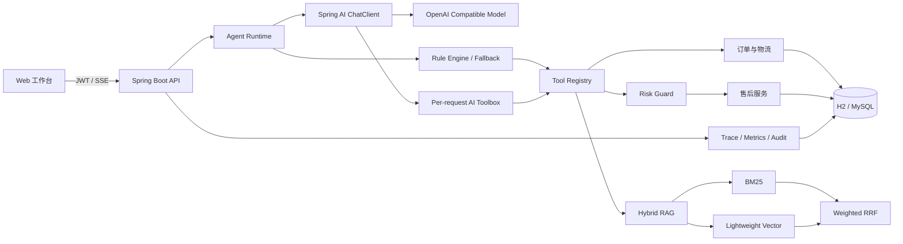
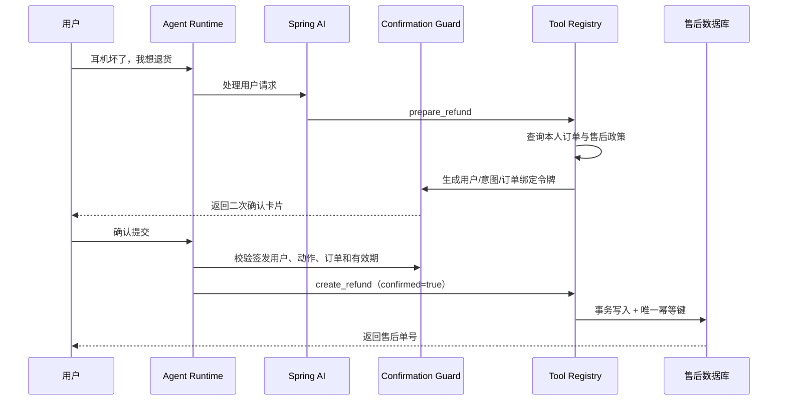

<div align="center">

# SmartService

**电商智能客服与售后协同 Agent 平台**

让大模型通过受控工具连接订单、物流、知识库与售后系统，完成从自然语言咨询到业务办理的完整闭环。


</div>

## 项目简介

SmartService 是一个基于 Java 17、Spring Boot 和 Spring AI 的电商客服 Agent。它不仅回答知识库问题，还能查询当前用户的真实订单与物流，在用户确认后创建售后工单，并记录完整调用轨迹。

项目采用 Spring AI 与确定性规则双引擎：配置模型后，由大模型选择只读或准备类工具；未配置密钥、模型超时、接口异常或漏调必要工具时，系统自动回退到规则编排。退款写入不会直接暴露给模型，始终由服务端完成身份校验、二次确认、幂等和事务控制。

## 核心亮点

| 能力 | 实现与证据 |
|---|---|
| 真实业务闭环 | 查询订单、追踪物流、检索政策、生成确认卡片、创建售后单、查看处理状态 |
| Spring AI Agent | `ChatClient`、流式响应、OpenAI 兼容模型、按请求隔离的 `@Tool` 工具集 |
| 双引擎运行 | Spring AI 负责语义理解与工具选择，规则引擎负责无密钥运行和异常降级 |
| 高风险操作安全 | 用户与订单归属校验、5 分钟确认令牌、意图绑定、风险分级、审计日志 |
| 幂等写入 | 确认令牌派生幂等键，数据库唯一索引兜底；100 次同键请求只新增 1 条记录 |
| 混合 RAG | 中文字词切分、Query Expansion、BM25、轻量向量召回、加权 RRF 与引用溯源 |
| 流式交互 | SSE 依次返回处理阶段、模型 Token、运行引擎、工具调用和最终结果 |
| 可观测性 | Agent Trace、工具耗时、P95 延迟、风险拦截次数、Micrometer 与 Prometheus |
| 可复现评测 | 30 篇知识文档、50 条检索样本、30 条意图样本、47 项自动化测试 |

## 可以演示什么

| 用户输入 | Agent 执行链 | 最终结果 |
|---|---|---|
| “帮我查一下耳机到哪了” | `query_order → query_logistics` | 返回本人订单和最新物流轨迹 |
| “这个耳机坏了，我想退货” | `prepare_refund → query_order + search_policy` | 返回政策依据和二次确认卡片 |
| 用户点击确认 | 服务端校验令牌 → `create_refund` | 事务创建售后单，重复提交返回原单号 |
| “退款一般多久到账” | `search_policy` | 返回带知识来源的政策回答 |

前端包含五个完整功能页面：

- **工作台**：订单概览、快捷业务入口、实时调用链。
- **Agent 会话**：独立对话页面、流式回复、工具执行状态、确认卡片。
- **售后工单**：工单列表、关联订单、退款金额和处理状态。
- **知识中心**：文档分类浏览以及 BM25、向量和 RRF 得分展示。
- **调用观测**：请求量、工具调用、安全拦截、P95 延迟和 Trace 明细。

## 系统架构



### 售后安全链路



## 技术栈

| 分类 | 技术 |
|---|---|
| 后端 | Java 17、Spring Boot 3.5.16、Spring MVC、Bean Validation |
| AI | Spring AI 1.1.8、ChatClient、Tool Calling、OpenAI Compatible API |
| 安全 | Spring Security、JWT、RBAC、Confirmation Token、Tool Risk Guard |
| 数据 | Spring JDBC、H2、MySQL 8.4、事务、唯一索引 |
| 检索 | BM25、Query Expansion、轻量向量、Weighted RRF |
| 前端 | HTML、CSS、原生 JavaScript、SSE |
| 观测 | Micrometer、Prometheus、Grafana、Agent Trace、Audit Log |
| 工程 | Maven、JUnit 5、MockMvc、Docker Compose |

## 快速开始

### 1. 环境要求

- JDK 17
- Maven 3.8+
- Docker Desktop（仅 MySQL、Prometheus 和 Grafana 场景需要）

```bash
java -version
mvn -version
```

### 2. 启动项目

克隆仓库并进入项目目录后执行：

```bash
mvn spring-boot:run
```

打开 <http://localhost:8080>。前端由 Spring Boot 一并提供，不需要执行 `npm install` 或启动第二个进程。

演示账号：

| 用户名 | 密码 | 权限 |
|---|---|---|
| `demo` | `demo123` | 普通用户 |
| `admin` | `demo123` | 管理员 |

默认使用内存 H2 和规则引擎，无需数据库、中间件或模型 API Key，即可演示订单、物流、知识检索、售后确认和工单写入。

### 3. 运行测试

```bash
mvn test
```

已下载全部依赖后，可以追加 `-o` 使用 Maven 离线模式。更完整的 Windows 命令、JAR 打包、MySQL Profile 和故障排查见[使用说明](docs/user-guide.md)。

## 启用 Spring AI 真实模型

项目使用 Spring AI 的 OpenAI 兼容接口。以 DeepSeek 为例，在启动前设置：

```powershell
$env:SMARTSERVICE_AI_ENABLED = 'true'
$env:SPRING_AI_MODEL_CHAT = 'openai'
$env:AI_API_KEY = '替换为真实密钥'
$env:AI_BASE_URL = 'https://api.deepseek.com'
$env:AI_MODEL = 'deepseek-chat'
mvn spring-boot:run
```

| 环境变量 | 说明 | 默认值 |
|---|---|---|
| `SMARTSERVICE_AI_ENABLED` | 创建业务侧 Spring AI Agent 服务 | `false` |
| `SPRING_AI_MODEL_CHAT` | 创建 Spring AI ChatModel；启用时设为 `openai` | `none` |
| `AI_API_KEY` | 模型服务密钥 | 空 |
| `AI_BASE_URL` | OpenAI 兼容服务地址 | `https://api.deepseek.com` |
| `AI_MODEL` | 模型名称 | `deepseek-chat` |

只有前两个开关同时启用且模型参数完整，`/api/agent/status` 才会返回 `SPRING_AI`。页面也会展示当前模型和是否发生规则降级。

Agent 工具与风险边界：

| 工具 | 风险等级 | 作用 |
|---|---|---|
| `query_order` | 只读 | 按当前认证用户查询订单 |
| `query_logistics` | 只读 | 查询指定本人订单的物流轨迹 |
| `search_policy` | 只读 | 检索售后、退款、物流等知识 |
| `prepare_refund` | 准备类 | 查询订单与政策并生成确认卡片，不写数据库 |
| `create_refund` | 高风险 | 不直接开放给模型，仅在用户确认后由服务端调用 |

## 评测结果

固定离线评测集和安全回放的当前结果：

| 指标 | 结果 |
|---|---:|
| 知识文档 | 30 篇 |
| 检索样本 | 50 条 |
| 意图样本 | 30 条 |
| 意图识别准确率 | 100%（30/30） |
| 关键词基线 Recall@1 | 86%（43/50） |
| 混合检索 Recall@1 | **96%（48/50）** |
| Recall@1 相对提升 | **11.6%** |
| 混合检索 Recall@3 | 98%（49/50） |
| 未确认高风险调用拦截率 | **100%（100/100）** |
| 同幂等键回放 100 次的新增记录 | **1 条** |
| 相比无幂等控制的重复写入降幅 | **99%** |
| Maven 自动化测试 | **47 项全部通过** |


## 主要 API

除登录和健康检查外，业务接口均需要 JWT。

| 方法 | 路径 | 说明 |
|---|---|---|
| `POST` | `/api/auth/login` | 登录并签发 JWT |
| `GET` | `/api/orders` | 查询当前用户订单 |
| `GET` | `/api/after-sales` | 查询当前用户售后工单 |
| `POST` | `/api/agent/chat` | 返回完整 Agent JSON 结果 |
| `POST` | `/api/agent/chat/stream` | 返回 Agent SSE 事件流 |
| `GET` | `/api/agent/status` | 查询 Spring AI / 规则运行模式 |
| `GET` | `/api/knowledge/search?query=...` | 混合检索及分项得分 |
| `GET` | `/api/knowledge/documents` | 查询知识文档 |
| `GET` | `/api/observability/summary` | 查询调用摘要和 Trace |
| `GET` | `/api/audits` | 查询当前用户敏感操作审计 |
| `GET` | `/api/admin/evaluation` | 管理员运行离线评测（ADMIN） |
| `GET` | `/actuator/health` | 应用健康检查 |
| `GET` | `/actuator/prometheus` | Prometheus 指标（ADMIN） |

SSE 事件类型：

```text
stage  -> 当前处理阶段
token  -> Spring AI 流式文本片段
engine -> 实际运行引擎、模型和降级状态
tool   -> 工具名称与执行耗时
result -> 完整 AgentResponse
```

## 项目结构

```text
SmartService/
├─ src/main/java/com/smartservice/
│  ├─ agent/          # Runtime、意图路由、工具注册、安全确认与 Spring AI
│  ├─ auth/           # 登录与用户账户
│  ├─ security/       # JWT、Spring Security 与 RBAC
│  ├─ order/          # 订单和物流查询
│  ├─ rag/            # BM25、向量召回、RRF 与知识接口
│  ├─ aftersale/      # 售后事务和幂等写入
│  ├─ observability/  # Trace 与指标汇总
│  ├─ audit/          # 敏感操作审计
│  └─ evaluation/     # 固定离线评测集
├─ src/main/resources/
│  ├─ static/         # 五个业务页面及前端交互
│  ├─ application.yml # 默认 H2 与 Agent 配置
│  ├─ schema.sql      # 演示库结构
│  └─ data.sql        # 订单、物流和知识样本
├─ src/test/          # 单元测试、评测测试和端到端集成测试
├─ deploy/            # Prometheus 配置
├─ docs/              # 使用、实现、评测、简历和面试文档
├─ docker-compose.yml # MySQL、Prometheus、Grafana
└─ pom.xml
```

